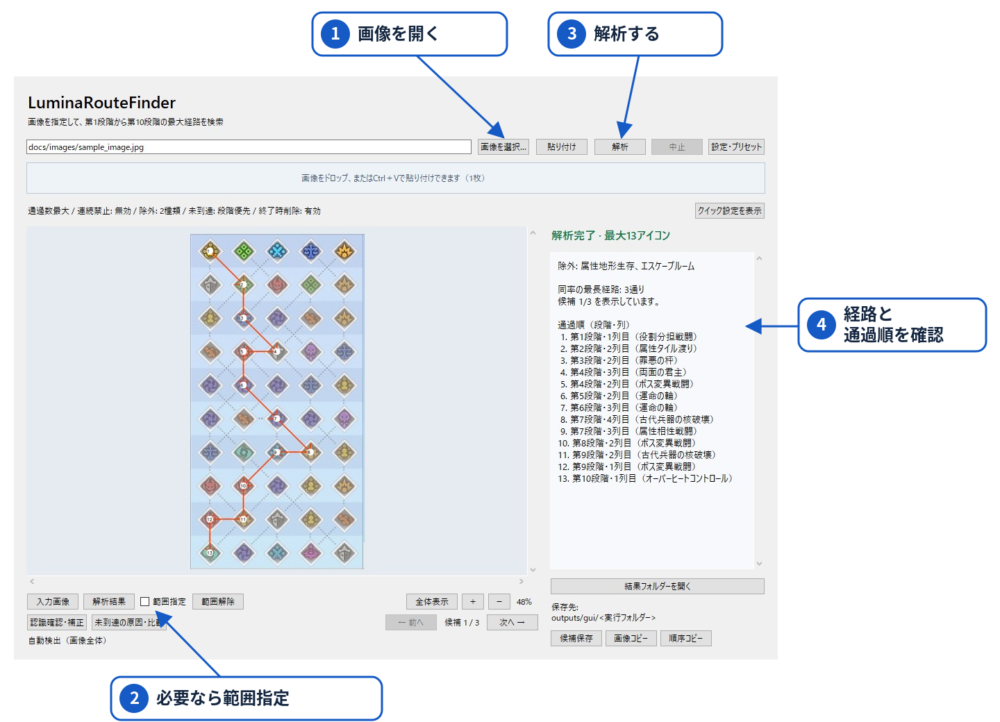
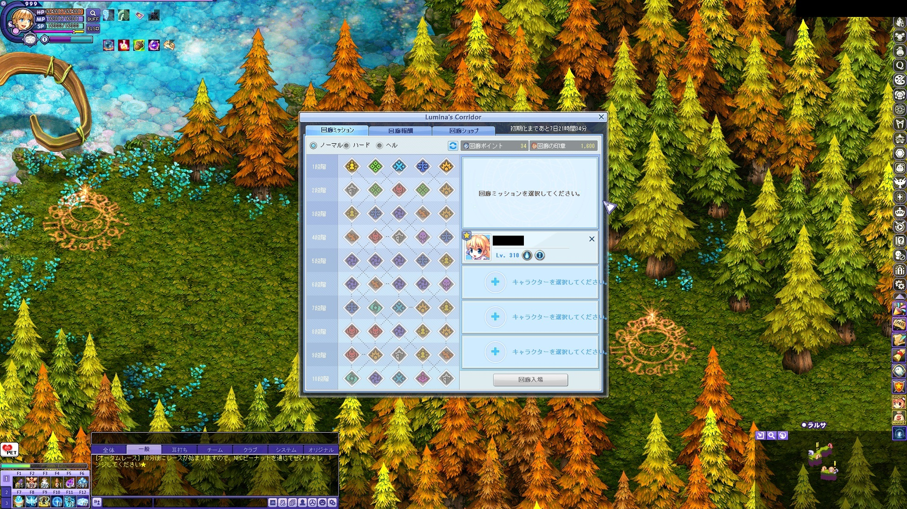

# LuminaRouteFinder

ルミナの回廊の画像から、第1段階から第10段階までの経路を探すツールです。
初期設定では、通るアイコンの数が最も多い経路を選びます。
避けたいコンテンツや、優先したいコンテンツも指定できます。

## Windows版をダウンロードして使う

Windows 10 / 11（64ビット）で使えます。

1. **[Windows版ZIPをダウンロード](https://github.com/T0m-n0-k4ti-desu/LuminaRouteFinder/releases/latest/download/LuminaRouteFinder-Windows-x64.zip)** します。
2. ダウンロードしたZIPを右クリックし、「すべて展開」を選びます。
3. 展開先のフォルダーを開き、`LuminaRouteFinder.exe` をダブルクリックします。

ZIPの中から直接起動せず、展開したフォルダーを使ってください。
初回の起動には少し時間がかかることがあります。

### ダウンロードや起動が止められたとき

配布exeには電子署名（発行元を確認するための証明）がありません。
警告が出た場合は、このページの配布リンクから入手したファイルか確認してください。

- **Edgeで「一般的にダウンロードされていません」と出る場合**：ダウンロード一覧の「…」→「保存」→「詳細表示」→「保持する」を選びます。
- **起動時に「WindowsによってPCが保護されました」と出る場合**：「詳細情報」→「実行」を選びます。

画面の表記は環境によって異なります。「実行」がない場合は、末尾の「開発版で開く」を参照してください。

設定は、exeと同じフォルダーの `gui-settings.json` に保存します。
更新するときはexeだけを入れ替えると、設定を引き継げます。

[リリース一覧](https://github.com/T0m-n0-k4ti-desu/LuminaRouteFinder/releases) · [変更履歴](CHANGELOG.md)

## 基本の使い方

1. 「画像を選択…」でゲーム画面の画像を開きます。画像をアプリへドラッグしても読み込めます。
2. 必要なら「範囲指定」をオンにし、盤面全体をドラッグで囲みます。
3. 「解析」を押します。
4. 画像上の経路と、右側の通過順を確認します。「前へ」「次へ」で別の候補を表示できます。

Win＋Shift＋Sで撮った画像は、「貼り付け」またはCtrl＋Vで読み込めます。
画像を読み込むだけでは、解析は始まりません。



画像は「＋」「－」で拡大・縮小できます。拡大後はドラッグして表示位置を動かせます。
「範囲指定」がオンの間は、ドラッグで解析範囲を選びます。
「全体表示」で画像全体を表示し、「範囲解除」で範囲の指定を取り消せます。

### 経路の条件を変える

「設定・プリセット」を開き、条件を選びます。変更後は「解析」を押してください。
設定は次回の起動にも引き継ぎます。

| 設定 | できること |
|---|---|
| 同じコンテンツの連続を禁止 | 同じ種類のマスを続けて通らないようにします。 |
| 指定コンテンツを除外 | 選んだ種類のマスを避けます。複数選べます。 |
| 経路評価 | 通過数や、種類ごとに付けた重み（優先度を表す数値）で経路を選びます。 |
| プリセット | よく使う条件に名前を付けて保存します。 |

連続禁止と除外は、初期設定ではオフです。両方を同時に使うこともできます。
重みを使っても、ゲーム内の点数や報酬を計算するわけではありません。

### ゴールまで進めないとき

初期設定では、できるだけ下の段階まで進む経路を表示します。
「ゴール未到達時」で、通過数などを優先する方法にも変更できます。

「未到達の原因・比較」では、進めない原因と、条件を緩めた場合の経路を確認できます。
比較した条件は、選んで適用するまで元の設定に反映されません。

## 読み取れる画像

**5列×10段の全50アイコンと、接続線がすべて見える画像**を使ってください。
盤面だけを切り抜いた画像でも使えます。



- カーソルや別のウィンドウで、アイコンや線を隠さないでください。
- 第2段階以降を選んで上の経路が消えている場合は、選択を解除して撮り直してください。
- 小さく縮めた画像より、元のスクリーンショットを使ってください。

### 読み取れないとき

| 状況 | 試すこと |
|---|---|
| 盤面が見つからない・複数見つかる | 「範囲指定」で対象の盤面全体を囲みます。 |
| アイコンや線が隠れている・欠けている | 盤面全体が見える状態で撮り直します。 |
| コンテンツの種類がわからない | 「認識確認・補正」で、読み取った種類を確認・修正します。 |

種類を使う条件が不要なら、除外と連続禁止をオフにし、経路評価を「通過数最大」に戻して試せます。
詳しい理由は、画面のエラーメッセージを確認してください。

## 結果を保存する

「候補保存」で、表示中の経路を画像として保存できます。
「画像コピー」「順序コピー」で、画像や通過順をコピーできます。

**初期設定では、アプリを閉じると今回の解析結果と貼り付け画像を削除します。**
残したい画像は、閉じる前に「候補保存」で別のフォルダーへ保存してください。
「設定・プリセット」で終了時の削除をオフにすることもできます。
元の画像や設定ファイルは削除しません。

自動保存されたファイルは「結果フォルダーを開く」から確認できます。
Windows版の保存先は、exeと同じ場所の `outputs/gui/` です。

## 開発版で開く（Python）

Windowsでの手順です。Python 3.10以降が必要です。以下では3.13を使います。

### 1. Pythonを入れる

[Python公式サイト](https://www.python.org/downloads/windows/)から「Python install manager」をダウンロードします。
ダウンロードしたファイルを開き、「Install」でインストールします。

スタートメニューで「PowerShell」を検索して開き、次の行を貼り付けてEnterを押します。

```powershell
py install 3.13
```

`py` が見つからない場合は、PowerShellを開き直してください。
すでにPython 3.13を使える場合、この準備は不要です。

### 2. アプリのファイルを用意する

1. **[プログラム一式をダウンロード](https://github.com/T0m-n0-k4ti-desu/LuminaRouteFinder/archive/refs/heads/main.zip)** します。
2. ZIPを右クリックし、「すべて展開」を選びます。
3. 展開先で `requirements.txt` があるフォルダーを開きます。
4. エクスプローラー上部のアドレス欄に `powershell` と入力し、Enterを押します。

### 3. 準備して起動する

開いたPowerShellで、次の3行を1行ずつ実行します。
必要なファイルのダウンロードには、インターネット接続が必要です。

```powershell
py -3.13 -m venv .venv
.\.venv\Scripts\python.exe -m pip install -r requirements.txt
.\.venv\Scripts\python.exe -m lumina_route_finder.gui
```

最初の2行で、このアプリ用のPython環境と必要な部品を用意します。
最後の行で画面が開きます。

**次回からは**、同じフォルダーでPowerShellを開き、最後の1行だけ実行します。
ファイルが見つからないと出た場合は、`requirements.txt` があるフォルダーを開いているか確認してください。
