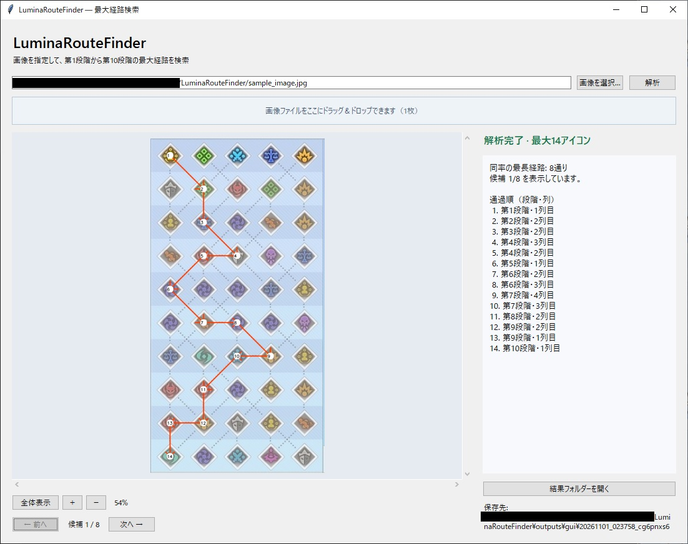
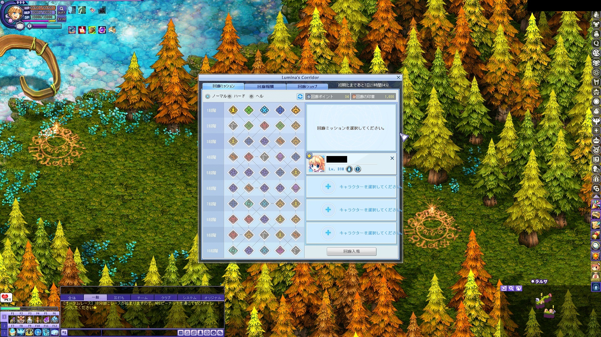

# LuminaRouteFinder

Lumina’s Corridorのスクリーンショットから、**第1段階から第10段階までに通れるアイコン数が最大になる経路**を探すツールです。点数や報酬ではなく、起点・終点を含む通過アイコン数で比較します。

- 画像ファイルの選択・パス入力・ドラッグ＆ドロップ・クリップボード貼り付けに対応
- 入力画像のプレビューと、ドラッグによる解析範囲の指定
- 最大通過数・経路画像・通過順の表示と、同率候補のページ切り替え
- コンテンツの除外・同じコンテンツの連続禁止を指定した探索
- 読み取れない画像のエラー理由表示と、終了時の生成ファイル削除

## ダウンロード・起動

Windows 10 / 11の64ビット向けです。Pythonのインストールは不要です。

**[Windows版ZIPをダウンロード](https://github.com/T0m-n0-k4ti-desu/LuminaRouteFinder/releases/latest/download/LuminaRouteFinder-Windows-x64.zip)**

[exe単体](https://github.com/T0m-n0-k4ti-desu/LuminaRouteFinder/releases/latest/download/LuminaRouteFinder.exe) · [SHA-256チェックサム](https://github.com/T0m-n0-k4ti-desu/LuminaRouteFinder/releases/latest/download/SHA256SUMS.txt) · [リリース一覧](https://github.com/T0m-n0-k4ti-desu/LuminaRouteFinder/releases) · [変更履歴](CHANGELOG.md)

ZIPを任意の書き込み可能なフォルダーへ展開し、`LuminaRouteFinder.exe` をダブルクリックしてください。ZIPには次の2ファイルが入っています。

```text
LuminaRouteFinder.exe
gui-settings.json
```

初回起動は内部ファイルの展開に少し時間がかかる場合があります。配布exeにはコード署名を付けていません。更新時に自分の設定を引き継ぐ場合は、exeだけを差し替えてください。

## 基本の使い方

1. 画像を選択・D&Dするか、画像のパスを入力します。Win＋Shift＋Sでコピーした画像は「貼り付け」またはCtrl＋Vで読み込めます。
2. 表示された入力画像を確認します。必要に応じて「範囲指定」をオンにし、盤面全体をドラッグで囲みます。
3. 探索条件を指定し、「解析」を押します。画像を読み込んだだけでは解析は始まりません。
4. 最大通過数・経路画像・通過順を確認します。同率の候補がある場合は「前へ／次へ」で切り替えられます。



右側の通過順・説明欄はスクロールバーやマウスホイールで末尾まで確認できます。候補を切り替えると説明欄は先頭に戻ります。

「入力画像／解析結果」で表示を切り替え、「全体表示」「＋」「－」で倍率を調整できます。拡大した画像はドラッグやスクロールで移動できます。「範囲指定」がオンの入力画像では、ドラッグは範囲選択になります。

### 解析する範囲を指定する

5列×10段の全アイコンと接続線を、少し余白を残して囲んでください。その範囲内だけで盤面を自動検出するので、厳密な縦横比で囲む必要はありません。背景に別の盤面がある場合にも使えます。

「範囲解除」で画像全体の自動検出に戻ります。画像や範囲を変更すると以前の結果を消すため、もう一度「解析」を押してください。隠れた線や欠けたアイコンを復元する機能はありません。

### 探索条件を指定する

どちらも初期状態ではオフです。両方を指定した場合は、両条件を満たす中で最長の経路を探します。

| 条件 | 動作 |
|---|---|
| 同じコンテンツの連続を禁止 | 同じ種類が続く移動を禁止します。別の種類を挟んだ再登場は許可します。 |
| 指定コンテンツを除外 | 一覧で選んだ種類のマスを通りません。複数選択できます。 |

条件を変えたら再解析してください。通過順には判別できたコンテンツ名も表示します。条件を満たして第10段階へ到達できない場合は、その旨を表示します。条件を指定した探索でコンテンツの種類を判別できない場合は、エラーとして停止します。

### 経路のルール

第1段階の5つのアイコンは、どれも起点にできます。原則として上から下へ進み、横の点線は左右どちらにも移動できます。第1・第10段階の横移動も通過数に含めます。

上への移動、同じアイコンの再訪、斜めの線の交差点で別の線へ乗り換える移動はできません。同率候補は最初に最大20件を取得し、ページを進めると追加取得します。

## 読み取れる画像・撮影時の注意

画面全体の縦横比・解像度・ウィンドウ位置は固定していません。背景を含む画像、盤面だけの切り抜き、クリップボード画像に対応します。背面に別のウィンドウがあっても、対象の盤面全体が見えていれば解析できます。



- **全50個のアイコンと、その間の接続線を残してください。** タイトルバー・右側の説明欄・ゲーム背景は切り取れます。
- 第2段階以降のアイコン選択を解除し、上側を含む全経路を表示してください。第1段階の選択は受け付けます。
- ゲーム内カーソルや他のウィンドウで、盤面のアイコン・接続線を隠さないでください。
- できるだけ元のスクリーンショットを使ってください。過度な縮小・再圧縮・回転・強い変形では認識できないことがあります。

入力サンプルは [docs/images/sample_image.jpg](docs/images/sample_image.jpg)、盤面だけのサンプルは [tests/fixtures/board_crop.jpg](tests/fixtures/board_crop.jpg) にあります。

### エラーになったとき

エラー時は日本語の理由と対処方法を表示します。盤面を検出できた場合は、エラー箇所を示す画像も表示します。

| 状況 | 対処 |
|---|---|
| 盤面が見つからない | 元の解像度の画像を使い、盤面全体を範囲指定します。 |
| 複数の盤面が見つかる | 対象の1つだけを範囲指定します。 |
| 選択によって上の経路が消えている | ゲーム内の選択を解除して撮り直します。 |
| カーソル遮蔽・アイコン欠損・接続線が不鮮明 | 盤面全体が鮮明に見える状態で撮り直します。 |
| 探索条件に必要なコンテンツの種類が不明 | 鮮明な画像を使うか、除外・連続禁止をオフにして解析します。 |

不確かな接続を推測して結果に含めることはありません。初めて使う撮影条件では、結果フォルダーの `recognized.png` で認識した接続も確認してください。

## 結果の保存と設定

Windows版はexeと同じ場所の `outputs/gui/` に、解析ごとのフォルダーを作ります。「結果フォルダーを開く」から参照できます。経路画像の `route.png`、認識確認用の `recognized.png`、詳細な `result.json` などを保存します。貼り付け画像は `outputs/gui/clipboard/` にPNGで保存します。

**「終了時に今回の出力（解析結果・貼り付け画像）を削除」は初期設定で有効です。** 結果を残したい場合はチェックを外すか、終了前に必要なファイルを別の場所へ保存してください。解析中に閉じた場合は完了を待ってから削除します。

削除するのは今回のGUI起動で生成したファイルと、空になった出力フォルダーだけです。元画像・以前の出力・設定ファイル・自分で追加したファイルは残ります。削除できなかったファイルは通知します。

設定はexe横の `gui-settings.json` に保存し、次回起動へ引き継ぎます。有効な設定がここにあれば優先し、なければ旧出力先の設定を移行します。どちらもなければ初期値で起動し、チェック変更時または通常終了時に保存します。

## Pythonで使う・開発する

Python 3.10以降でも実行でき、外部APIやOCR実行ファイルは使いません。

[Pythonのセットアップ・CLI・テスト・ビルドとリリース手順](docs/DEVELOPMENT.md) · [設計書](DESIGN.md)
