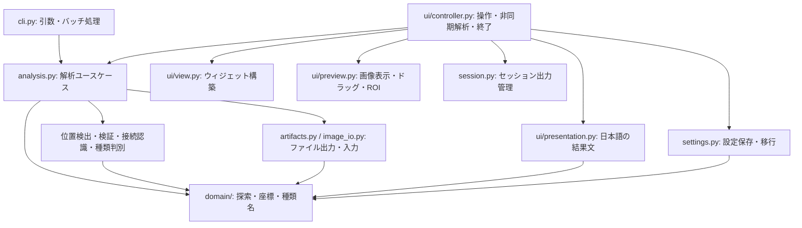

# コード構成と責務

このアプリは、純粋な探索処理を中心に置くレイヤード構成と、GUIのView／Controller分離を採用しています。クリーンアーキテクチャの依存方向を参考にしていますが、全処理にInterfaceやRepositoryを置く構成にはしていません。解析の実行部分が具体的な画像・ファイル処理を組み合わせる、Functional Core / Imperative Shellの構成です。

## 依存方向

`domain/` はGUI、OpenCV、ファイル保存に依存しません。設定の検証と結果文の整形も、TkやOpenCVを読み込まず使えます。CLIと解析ユースケースはGUIに依存しません。これらの境界は `tests/test_architecture.py` で確認します。

## 変更する場所

| 変更内容 | 主な変更先 |
|---|---|
| 経路の制約・最長経路・途中経路 | `lumina_route_finder/domain/solver.py` |
| コンテンツIDと名前 | `lumina_route_finder/domain/catalog.py` |
| 盤面の座標・経路の出力座標 | `lumina_route_finder/domain/geometry.py` |
| 画像解析の実行順序、範囲指定、探索条件 | `lumina_route_finder/analysis.py` |
| CLIの引数・入力列挙 | `lumina_route_finder/cli.py` |
| JSON・診断画像・経路画像の保存 | `lumina_route_finder/artifacts.py`、`render.py`、`image_io.py` |
| タイトルと格子による位置検出 | `lumina_route_finder/board_location.py`、`locate.py` |
| アイコン欠損・選択・カーソルの検査 | `lumina_route_finder/board_validation.py` |
| 接続線の判定 | `lumina_route_finder/recognize.py` |
| コンテンツの画像照合 | `lumina_route_finder/contents.py` |
| 画面配置・ウィジェット・イベント接続 | `lumina_route_finder/ui/view.py` |
| 拡大・スクロール・ドラッグ・範囲選択の座標変換 | `lumina_route_finder/ui/preview.py` |
| 表示文・エラー文・通過順 | `lumina_route_finder/ui/presentation.py` |
| エラーコード・共通例外・失敗結果への正規化 | `lumina_route_finder/errors.py` |
| 利用者向けエラー文と重複排除 | `lumina_route_finder/error_messages.py` |
| GUI入力・ワーカー・候補切替・終了待機 | `lumina_route_finder/ui/controller.py` |
| 設定ファイルの検証・保存・移行 | `lumina_route_finder/settings.py` |
| 今回の出力登録・終了時削除 | `lumina_route_finder/session.py` |

## GUIの分担

`ApplicationView` はウィジェットを構築し、操作をControllerのコールバックへ接続します。解析やファイル操作は実行しません。

`ImagePreview` は表示画像とカメラ状態を所有します。操作可能かどうかをコールバックで受け取り、範囲確定時には矩形をControllerへ通知します。探索・設定保存・解析スレッドについては知りません。

`Application` はViewとPreviewを組み立てます。Tkの操作は主スレッドで行い、ワーカーは共通の解析ユースケースを呼んで結果をキューへ渡します。解析出力の生成直後の登録と、終了時の完了待機は維持しています。

## 既存の起動口と互換性

- `python -m lumina_route_finder` と `python -m lumina_route_finder.gui` は同じままです。
- `gui.py` は `Application`、`main`、`describe_result`、`analyze_file` への公開窓口です。
- `__main__.py` の `run_image`、`write_image`、`export_solution` は引き続きインポートできます。
- `solver.py` は純粋な探索処理への互換インポートです。新しい内部コードは `domain.solver` を参照します。
- `session.py` からの既存の設定関数のインポートは維持します。実装は `settings.py` にあります。
- `recognize.py` からの位置検出・検証・画像読込関数の既存インポートも維持します。
- exeの診断起動が利用する `Application.path`、`status`、`image`、`region` と解析・終了操作は維持しています。

新しいコードは互換窓口ではなく、責務を持つ実装モジュールを直接参照してください。GUI内部のウィジェットは `app.view`、プレビュー状態・操作は `app.preview` にあります。テストで差し替える関数も、その関数を実際に使うモジュールで差し替えます。

## 変更の確認

既存のGUI・CLI・認識・探索・設定・配布テストを引き続き実行します。コードの移動だけで画面の文言、探索条件、設定形式、出力ファイルを変更しないようにします。今回の分割では、同梱画像による通常解析・条件付き解析・範囲指定のJSON／PNG成果物が分割前とバイト単位で一致し、不正画像のエラー結果も一致することを確認しました。

複数の機能を同時に変更する際は、上の表で主な変更先を分けてください。新しい画像操作でViewのレイアウトや探索処理まで変更する、といった責務の混在を避けます。

## エラーの扱い

`errors.py` の `ErrorCode` がコードを定義し、`issue()` が既存の `code`／`message`／任意の `board_box` 形式を作ります。Enumを渡してもJSONのコードは従来と同じ文字列です。既知の業務エラーは `ApplicationError` で表現し、画像認識の公開例外 `RecognitionError` はそのサブクラスとして維持します。画像や原点などの診断用情報も保持します。

`error_messages.py` は利用者向け日本語メッセージを一元管理します。GUIの結果表示、入力検証、クリップボード、設定、出力の案内に同じ整形関数を使います。診断用の詳細は `message` に残し、未知のコードは診断文へフォールバックします。メッセージの翻訳や重複排除は、認識処理やTkウィジェットに置きません。

CLIとGUIワーカーの境界では `failure_issues()`／`error_result()` で例外を共通形式にします。既知の `ApplicationError` のコードは保持し、出力操作でのOSエラーは `OUTPUT_WRITE_ERROR`、予期しない障害は `ANALYSIS_FAILED` に分けます。GUIは日本語文へ整形し、CLIは従来の機械可読コードを表示します。保存そのものが失敗した場合、結果ファイルを保存できたことにはしません。

探索の `partial`／`no_path` はエラー例外に変換しません。純粋な探索APIの不正な引数など、プログラマー向けの検証は引き続き `ValueError` です。予期しない例外を業務エラーに偽装して握りつぶす用途には使いません。
